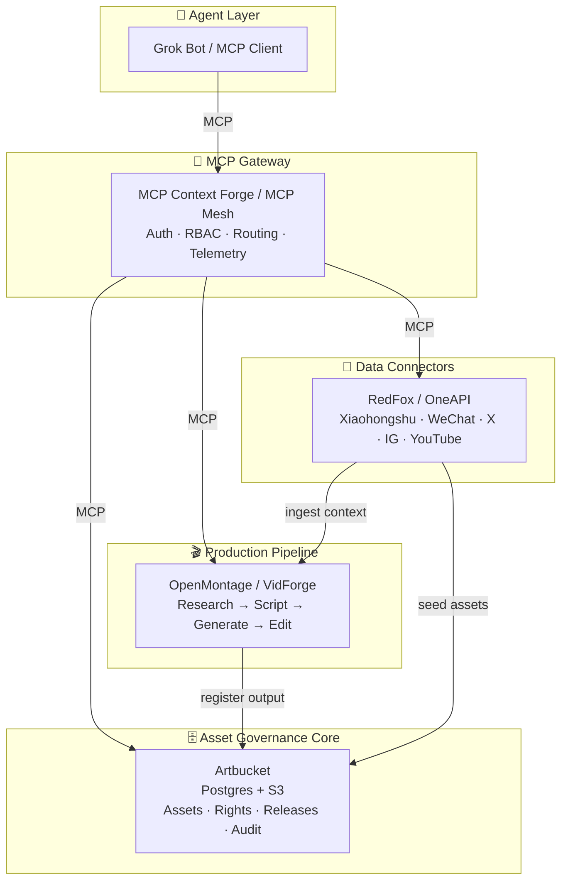

# ai-native-dam
AI-native digital asset management for agent-driven social media operations — MCP-first governance, provenance, and multi-platform content pipelines.
<div align="center">

# AI-Native DAM

**Agent-driven digital asset management · MCP-first · Provenance-native**

[](./LICENSE)
[](#roadmap)
[](https://www.typescriptlang.org/)
[](https://modelcontextprotocol.io/)
[](https://docs.docker.com/compose/)
[](./CONTRIBUTING.md)

An AI-native digital asset management platform for agent-driven social media operations —
MCP-first governance, provenance, and multi-platform content pipelines
across **X · YouTube · Instagram · Xiaohongshu · WeChat Channels**.

[Why](#why-ai-native-dam) · [Features](#features) · [Architecture](#architecture) · [Quick Start](#quick-start) · [MCP Tools](#mcp-tools) · [Roadmap](#roadmap) · [Contributing](#contributing)

</div>

---

## Why AI-Native DAM?

Traditional DAMs treat assets as **files in folders**. AI-native operations need something different:

- Agents must be able to **query rights, not remember them**.
- Every generated asset must carry **provenance** — model, prompt, license, source.
- Publishing rules (channel, territory, embargo) must be **data**, not tribal knowledge.
- The platform must expose **one contract** — MCP — to every consumer: human UI, bot, CLI, or another agent.

This project is the **assembly and governance layer** that connects proven open-source components
into a coherent, agent-first asset platform. It does not reinvent DAM storage, video pipelines, or
social connectors — it **governs** them.

> **Design principle:** *Compose, don't rewrite. Govern, don't duplicate.*

---

## Features

| | Capability | Notes |
|---|---|---|
| 🧠 | **MCP-native interface** | Every platform capability is exposed as MCP tools; Web UI is just another client. |
| 🔐 | **Rights-as-data** | Assets carry license, channel, territory, embargo — queryable via `check_use`. |
| 🧾 | **Provenance tracking** | C2PA / IPTC / XMP read-write; model, prompt and source are first-class metadata. |
| 🌐 | **Multi-platform connectors** | X, YouTube, Instagram, Xiaohongshu, WeChat Channels — pluggable adapters. |
| 🤖 | **Agent orchestration** | Grok Bot (or any MCP client) drives research → generation → publishing workflows. |
| 🎬 | **Production pipeline hooks** | Video/asset generation pipelines register outputs back into the DAM automatically. |
| 🧩 | **Pluggable by design** | Every external service sits behind an interface — swap vendors without touching core. |
| 🏠 | **Self-hosted & auditable** | Docker Compose deployment, Postgres + S3-compatible storage, no telemetry. |

---

## Architecture



**Layers, from top to bottom:**

1. **Agent Layer** — Grok Bot or any MCP client, holding user-scoped credentials.
2. **MCP Gateway** — single entry point: auth, RBAC, routing, approval gates, observability.
3. **Asset Governance Core** — the source of truth: assets, rules, rights, releases, audit trail.
4. **Production Pipeline** — generation and editing, exposed as its own MCP tool domain.
5. **Data Connectors** — platform-specific data acquisition, wrapped behind a stable interface.

---

## Tech Stack

| Layer | Choice | Why |
|---|---|---|
| Language | **TypeScript** (orchestrator, gateway) · **Python** (connectors) | Type safety for governance; ecosystem for data collection. |
| Database | **PostgreSQL** | Relational integrity for rights, releases, audit. |
| Object Storage | **S3-compatible** (MinIO / R2 / S3) | Portable, self-hostable. |
| Protocol | **MCP** | One contract for humans, bots, CLI, and agents. |
| Deployment | **Docker Compose** | Reproducible, low-ops, self-hosted. |
| Observability | **OpenTelemetry** | Trace every tool call across agents and services. |

---

## Quick Start

### Prerequisites

- Docker ≥ 24 and Docker Compose ≥ 2
- Node.js ≥ 22 (for local orchestrator development)
- Python ≥ 3.11 (for connector development)

### Boot the stack

```bash
git clone https://github.com/<your-org>/ai-native-dam.git
cd ai-native-dam

cp .env.example .env          # set APP_SECRET, JWT_SECRET, BASE_URL, S3 creds
docker compose up -d          # Postgres + MinIO + Artbucket + Gateway

# verify the core
curl -s http://localhost:8080/api/v1/mcp/health
```

### Connect an MCP client

```json
{
  "mcpServers": {
    "ai-native-dam": {
      "url": "http://localhost:8080/mcp",
      "headers": { "Authorization": "Bearer ${DAM_TOKEN}" }
    }
  }
}
```

The agent now has access to the full tool surface — **only what the issuing user is permitted to do**.
No private endpoints, no hidden Web-only features.

---

## Project Structure

```text
ai-native-dam/
├── docker-compose.yml          # One-command stack
├── .env.example
├── packages/
│   ├── orchestrator/           # TS orchestration layer (thin adapter, no business logic)
│   ├── mcp-gateway/            # Gateway config: routing, RBAC, approval policies
│   ├── connectors/             # RedFox / OneAPI adapters (Python, pluggable interface)
│   └── shared-schema/          # Shared types, Zod schemas, MCP tool contracts
├── infra/
│   ├── migrations/             # DAM schema extensions (channels, territory, embargo)
│   └── seed/                   # Initial brands, channels, rights profiles
├── policies/                   # Approval gates, permission rules, risk levels
├── docs/
│   ├── architecture.md
│   └── mcp-tools.md            # Canonical tool contract for agents
└── README.md
```

**Boundary rule:** `orchestrator` handles identity, permissions, error normalization and
approval flow. It **must not** reimplement asset or pipeline logic — that lives in the services it composes.

---

## MCP Tools

The canonical contract lives in [`docs/mcp-tools.md`](./docs/mcp-tools.md). A representative slice:

| Tool | Risk | Gated | Description |
|---|---|---|---|
| `search_assets` | low | — | Query assets by tag, metadata, channel, or semantic similarity. |
| `check_use` | low | — | Can this asset be used on *channel X* in *territory Y* now? Returns replacement if not. |
| `create_asset` | medium | ✅ | Ingest a file with provenance; requires rights declaration. |
| `set_rights` | medium | ✅ | Attach license, territory, embargo, channel scope. |
| `record_usage` | medium | ✅ | Log a use; rejected if rights are not `Cleared` for the target. |
| `produce_and_register` | high | ✅ | Composite: `check_use → pipeline → create_asset → set_rights → record_usage`. |
| `collect_hot_topics` | low | — | Fetch trending topics from Xiaohongshu / WeChat / X / YouTube. |

**Risk levels follow the same model as `mcp-dam`:** `writes_allowed = gated`,
every write is reviewable, every read is scoped to the calling user.

---

## Roadmap

| Phase | Focus | Deliverables |
|---|---|---|
| **0 · Bootstrap** | Core stack | Docker Compose, Artbucket running, MCP health check, minimum tool chain. |
| **1 · Connect** | Data layer | RedFox adapter, MCP gateway, hot-topic discovery loop. |
| **2 · Produce** | Pipeline | OpenMontage MCP integration, `produce_and_register` contract. |
| **3 · Govern** | Multi-tenant | Channel/rights templates per client, approval flows, audit dashboards. |
| **4 · Extend** | Ecosystem | Pluggable connectors SDK, community tool registry. |

Status: **Phase 0 — seeking early collaborators.** See [open issues](https://github.com/<your-org>/ai-native-dam/issues).

---

## Contributing

We welcome contributions at every layer — connectors, tool contracts, governance policies,
and documentation. Please read [`CONTRIBUTING.md`](./CONTRIBUTING.md) and our
[`CODE_OF_CONDUCT.md`](./CODE_OF_CONDUCT.md) before opening a PR.

**Good first issues** are tagged `good first issue` and typically involve:

- a new connector behind the `SocialDataSource` interface
- a new MCP tool contract with tests
- a governance policy example in `policies/`

---

## License

Released under the [MIT License](./LICENSE).

> **Note on upstream licenses.** This repository *integrates with* AGPL-3.0 projects
> (e.g. Artbucket, OpenMontage) as **separate services via MCP**, not as embedded code.
> Please review each upstream project's license before commercial redistribution.

---

## Acknowledgements

This project stands on the shoulders of excellent open-source work:

- **[Artbucket](https://github.com/)** — asset governance core, MCP-native DAM.
- **[mcp-dam](https://github.com/)** — governance gating model for agent tool contracts.
- **[OpenMontage](https://github.com/)** — agentic video production pipeline.
- **[MCP Context Forge](https://github.com/IBM/mcp-context-forge)** / **[MCP Mesh](https://github.com/)** — MCP gateway, federation, RBAC.
- **[RedFox](https://github.com/)** / **OneAPI** — social data acquisition.
- **[Model Context Protocol](https://modelcontextprotocol.io/)** — the contract that makes agent-first design possible.

---

<details>
<summary><b>中文简介</b></summary>

### AI-Native DAM（面向 Agent 运营的 AI 原生数字资产管理平台）

本项目是一个 **AI 原生数字资产管理平台**，面向由 Agent（如 Grok Bot）驱动的社交媒体运营：
以 **MCP 优先** 的方式治理资产、权利与溯源，并通过可插拔的数据连接器与生产流水线，
覆盖 **X、YouTube、Instagram、小红书、视频号** 多平台内容生产与发布。

**核心理念：** 组合与治理，而非重写。

- **资产、权利、溯源、发布** 都是一等数据，可通过 MCP 被 Agent 查询与操作。
- Web 界面只是 MCP 的一个客户端，**不存在私有端点**。
- 外部服务（存储、生产、采集）均以独立服务通过 MCP 集成，可随时替换。

**快速开始：**

```bash
git clone https://github.com/<your-org>/ai-native-dam.git
cd ai-native-dam && cp .env.example .env
docker compose up -d
```

详见 [架构](#architecture) 与 [MCP 工具](#mcp-tools)。

</details>
