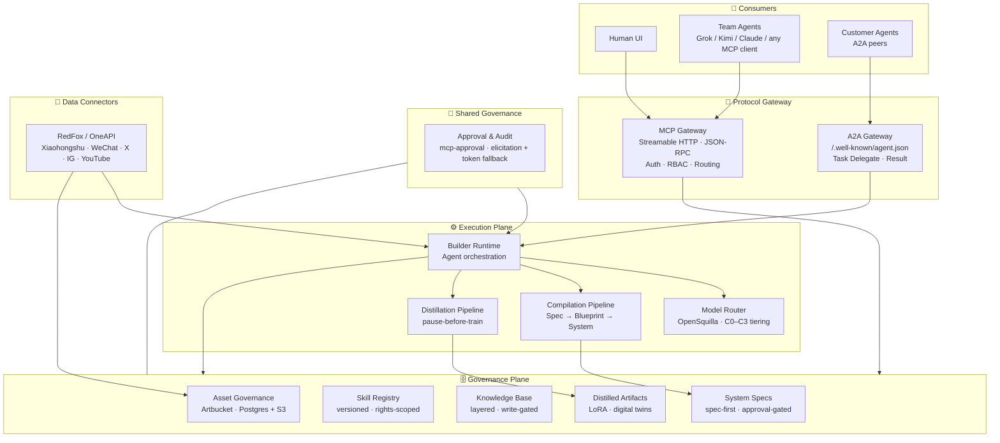

<div align="center">

# AI-Native DAM

**The governance plane for AI-native assets, skills, generated systems, and distilled capabilities.**

Agent-driven · MCP-first · A2A-ready · Provenance-native · Distillation-aware

[](./LICENSE)
[](#roadmap)
[](https://www.typescriptlang.org/)
[](https://modelcontextprotocol.io/)
[](https://a2a-protocol.org/)
[](https://docs.docker.com/compose/)
[](./CONTRIBUTING.md)

An AI-native governance plane for agent-driven operations — governing **media assets**, **skills**,
**generated systems**, **knowledge**, and **distilled artifacts** through one contract
across **X · YouTube · Instagram · Xiaohongshu · WeChat Channels**.

[Why](#why-ai-native-dam) · [What it governs](#what-it-governs) · [Architecture](#architecture) · [Quick Start](#quick-start) · [MCP Tools](#mcp-tools) · [A2A](#a2a-collaboration) · [Deploy](#deploy-on-cloudflare-pages) · [Roadmap](#roadmap) · [Contributing](#contributing)

</div>

---

## Why AI-Native DAM?

Traditional DAMs treat assets as **files in folders**. AI-native operations need something different:

- Agents must be able to **query rights, not remember them**.
- Every generated asset must carry **provenance** — model, prompt, license, source.
- Publishing rules (channel, territory, embargo) must be **data**, not tribal knowledge.
- The platform must expose **one contract** — MCP — to every consumer: human UI, bot, CLI, or another agent.
- **Systems themselves are assets.** An internal admin system generated from a conversation is not a one-off artifact; it is a governed, versioned, auditable capability that must be approved before it runs.
- **Skills are assets.** A distilled SOP, a digital twin, a LoRA adapter — all are capabilities that need rights, provenance, and approval, just like a brand image.
- **Agents collaborate peer-to-peer.** MCP connects agents to tools; A2A connects agents to agents. A governance plane must speak both.

This project is the **governance and assembly layer** that connects proven open-source components
into a coherent, agent-first platform. It does not reinvent DAM storage, video pipelines,
code generation, or social connectors — it **governs** them.

> **Design principle:** *Compose, don't rewrite. Govern, don't duplicate.*

---

## What It Governs

The governance plane treats **five kinds of capability** as first-class, versioned, auditable assets:

| Asset type | Examples | Governance primitive |
|---|---|---|
| **Media assets** | Images, videos, audio, documents | Rights, territory, embargo, channel scope |
| **Skills** | Distilled SOPs, workflow state machines, reusable agent capabilities | Who can invoke it, in which domain, at which version |
| **Generated systems** | E-commerce admin, short-drama management, retail order systems — produced from conversation | Spec-first approval before code runs; provenance of skills/models used |
| **Knowledge** | Layered entries: `raw` / `topic` / `manual` / `rule` / `qa` | Write-gated; source-traceable; layer-scoped retrieval |
| **Distilled artifacts** | LoRA adapters, digital twins, second-brain memory artifacts | Distilled from real usage; approved and versioned before reuse |

All five share the **same governance semantics**: `Rights` · `Provenance` · `Approval` · `Audit`.
This is the line between an AI-native platform and a folder full of files.

---

## Architecture



**Three planes, one contract:**

1. **Consumers** — humans and team agents use **MCP** (Streamable HTTP, JSON-RPC); customer agents use **A2A** for peer delegation via the Agent Card at `/.well-known/agent.json`[reference:0].
2. **Governance Plane** — the source of truth. Five asset classes. **Nothing runs until it is governed here.**
3. **Execution Plane** — generation and distillation. It reads from and writes back to the governance plane through the same MCP contract. **It never holds private state.**

**Boundary rule:** the execution plane **must not** invent its own approval or rights logic. It calls the governance plane's MCP tools. Governance is not optional.

---

## Tech Stack

| Layer | Choice | Why |
|---|---|---|
| Language | **TypeScript** (governance, gateway) · **Python** (connectors, runtime) | Type safety for governance; ecosystem for orchestration |
| Database | **PostgreSQL** | Relational integrity for rights, releases, specs, audit |
| Object Storage | **S3-compatible** (MinIO / R2 / SeaweedFS) | Portable, self-hostable |
| Tool Protocol | **MCP Streamable HTTP** | Single endpoint, each JSON-RPC message as an HTTP POST; SSE stream for multi-turn input[reference:1] |
| Agent Protocol | **A2A** | Peer discovery via Agent Card; task delegation without exposing internal state |
| Agent Runtime | **Mangaba AI** | Native MCP + A2A; ReAct; persistent memory |
| Model Routing | **OpenSquilla SquillaRouter** | C0–C3 tiering; routine work stays on cheap models, C3 reserved for hard reasoning[reference:2] |
| Approval Gate | **mcp-approval** | `elicitation` when the client supports it; two-call confirmation token as fallback[reference:3] |
| Deploy (showcase) | **Cloudflare Pages** | Git-integrated, unlimited bandwidth, 500 builds/month free |
| Deploy (services) | **Docker Compose** → Workers/R2/D1 later | Reproducible locally; edge-native when backend is ready |
| Observability | **OpenTelemetry** | Trace every MCP tool call and A2A delegation |

---

## Quick Start

### Prerequisites

- Docker ≥ 24 and Docker Compose ≥ 2
- Node.js ≥ 22 (for governance development)
- Python ≥ 3.11 (for runtime and connectors)

### 1. Boot the governance core (Artbucket)

```bash
git clone https://github.com/pwnera/artbucket.git
cd artbucket
cp .env.example .env
# Set BETTER_AUTH_SECRET:
openssl rand -base64 32
docker compose --profile app up -d
```

Open `http://localhost:3000` and create the first account — **it becomes the admin**; until it exists, nothing else works[reference:4]. Then add a file to verify the library works.

### 2. Verify the MCP endpoint

Artbucket exposes its MCP server at `/api/v1/mcp` over **Streamable HTTP**. Every JSON-RPC message is its own HTTP `POST`; the server replies with either a single JSON object or a per-request SSE stream[reference:5].

```bash
curl -s http://localhost:3000/api/v1/mcp \
  -H "Content-Type: application/json" \
  -H "Accept: application/json, text/event-stream" \
  -d '{"jsonrpc":"2.0","id":1,"method":"tools/list"}'
```

### 3. Connect an MCP client

```json
{
  "mcpServers": {
    "ai-native-dam": {
      "url": "http://localhost:3000/api/v1/mcp",
      "headers": { "Authorization": "Bearer ${DAM_TOKEN}" }
    }
  }
}
```

The agent now sees the full tool surface — **only what the issuing user is permitted to do**. No private endpoints, no Web-only features.

---

## Project Structure

```text
ai-native-dam/
├── docker-compose.yml          # Governance stack (Postgres + S3 + Artbucket + Gateway)
├── .env.example
├── packages/
│   ├── governance/             # Artbucket integration + asset/skill/spec schemas
│   ├── mcp-gateway/            # Streamable HTTP routing, RBAC, approval policies
│   ├── a2a-gateway/            # Agent Card, task delegation, result routing
│   ├── connectors/             # RedFox / OneAPI adapters (Python, pluggable)
│   └── shared-schema/          # Shared types, Zod schemas, MCP/A2A contracts
├── runtime/                    # Builder Runtime (separate deployment unit)
│   ├── orchestrator/           # Agent orchestration
│   ├── model-router/           # OpenSquilla integration
│   ├── compilation/            # Spec → Blueprint → System
│   └── distillation/           # tinker-ai-skill integration (gated)
├── infra/
│   ├── migrations/             # channels, rights, skills, specs, lora_artifacts
│   └── seed/                   # Initial brands, channels, rights profiles
├── policies/                   # Approval gates, permission rules, risk levels
├── docs/
│   ├── architecture.md
│   ├── mcp-tools.md            # Canonical MCP tool contract
│   └── a2a-contract.md         # Agent Card + task delegation schema
├── functions/                  # Cloudflare Pages Functions (MCP showcase endpoint)
└── README.md
```

**Boundary rule:** `governance` owns identity, rights, approval, audit. `runtime` owns generation and distillation. They communicate only through MCP (and, for external peers, A2A). Neither imports the other's business logic.

---

## MCP Tools

The canonical contract lives in [`docs/mcp-tools.md`](./docs/mcp-tools.md). Each tool declares its `risk_level`, `gated` status, and whether it is exposed to **Suggest / Read / Edit** scopes. Writes are **always** routed through `mcp-approval`; reads are scoped to the calling user.

### Media & Knowledge

| Tool | Risk | Gated | Description |
|---|---|---|---|
| `search_assets` | low | — | Query media by tag, metadata, channel, or semantic similarity |
| `check_use` | low | — | Can this asset be used on *channel X* in *territory Y* now? |
| `create_asset` | medium | ✅ | Ingest with provenance; requires rights declaration |
| `set_rights` | medium | ✅ | Attach license, territory, embargo, channel scope |
| `record_usage` | medium | ✅ | Log a use; rejected if rights are not `Cleared` for the target |
| `search_knowledge` | low | — | Query by layer (`raw` / `topic` / `manual` / `rule` / `qa`) |
| `write_knowledge` | medium | ✅ | Write a knowledge entry; requires approval |

### Skills & Systems

| Tool | Risk | Gated | Description |
|---|---|---|---|
| `search_skills` | low | — | Query Skill Registry by domain and rights scope |
| `apply_skill` | medium | ✅ | Invoke a skill version; records usage against provenance |
| `generate_system_spec` | medium | ✅ | Draft a System Spec from conversation + skills + knowledge |
| `submit_system_spec` | high | ✅ | Submit for approval; generation runs **only after approval** |
| `register_generated_system` | high | ✅ | Register the output as a governed asset with full provenance |

### Distillation

| Tool | Risk | Gated | Description |
|---|---|---|---|
| `request_distillation` | medium | ✅ | Flag a skill/twin after N uses; **pauses before training** |
| `register_lora_adapter` | high | ✅ | Register a distilled adapter as a versioned asset |

**Approval semantics.** `mcp-approval` asks a human via `elicitation` whenever the client supports it; when it cannot, it falls back to a **two-call confirmation token** — the first call returns a random string, the second must quote it back. The token proves the call was made twice with the same arguments; `elicitation` is what actually closes the loop, because the model cannot answer on the person's behalf[reference:6].

---

## A2A Collaboration

A2A is the **peer surface**, not a replacement for MCP. Customer agents discover this platform through the Agent Card at:

```text
GET /.well-known/agent.json
```

The card carries `name`, `description`, `url`, `version`, `protocolVersion`, `capabilities`, `skills`, and `securitySchemes`[reference:7]. A customer agent can then **delegate** a task — for example, “generate a read-only retail order admin” — without ever seeing which internal skills or models the Builder Runtime used.

**MCP changes the transport; A2A changes the relationship. Both go through the same Rights and Approval gate.**

---

## Deploy on Cloudflare Pages (showcase layer)

At this stage the repository has no build step and no running backend. Cloudflare Pages is the right fit for the **public showcase** — connect the Git repo, and every push to `main` redeploys automatically.

### 1. Add a minimal `index.html` at the repository root

```html
<!DOCTYPE html>
<html lang="en">
<head>
  <meta charset="UTF-8">
  <meta name="viewport" content="width=device-width, initial-scale=1.0">
  <title>AI-Native DAM</title>
  <link rel="stylesheet" href="https://cdnjs.cloudflare.com/ajax/libs/github-markdown-css/5.6.1/github-markdown.min.css">
  <style>
    body { box-sizing: border-box; max-width: 980px; margin: 0 auto; padding: 45px; }
    @media (max-width: 767px) { body { padding: 15px; } }
  </style>
</head>
<body class="markdown-body">
  <div id="content">Loading...</div>
  <script src="https://cdn.jsdelivr.net/npm/marked/marked.min.js"></script>
  <script>
    fetch('/README.md').then(r => r.text()).then(t => {
      document.getElementById('content').innerHTML = marked.parse(t);
    });
  </script>
</body>
</html>
```

### 2. Create the Pages project

Cloudflare Dashboard → **Workers & Pages** → **Create application** → **Pages** → **Connect to Git** → select `vfvincentwong2026/ai-native-dam`.

- **Framework preset**: `None`
- **Build command**: leave empty
- **Build output directory**: `/`

Deploy. You get `https://ai-native-dam.pages.dev`. Mermaid diagrams will not render in this plain `marked` setup, but badges, tables, links, and headings will.

### 3. Later: Pages Functions for a hosted MCP endpoint

When the MCP gateway is ready, you can expose a **read-only** MCP endpoint directly from Pages without standing up a separate Worker: Cloudflare Pages automatically picks up files under `functions/` and deploys them with the site[reference:8]. Put the MCP handler at `functions/mcp.js`, point a client at `https://ai-native-dam.pages.dev/mcp`, and keep the full runtime on your own Docker host until you are ready to move it to Workers + R2.

---

## Roadmap

| Phase | Focus | Deliverables |
|---|---|---|
| **0 · Foundation** | Governance plane | Artbucket running, MCP endpoint verified, first 5 media tools, `docs/mcp-tools.md` |
| **1 · Skills & Knowledge** | Capability registry | `search_skills`, `apply_skill`, layered knowledge base, write-gated |
| **2 · Spec-first Generation** | Builder Runtime | Orchestration, `generate_system_spec`, approval gate, **one SOP → one approved Spec** |
| **3 · A2A Collaboration** | Peer agents | Agent Card live, customer agents can delegate generation |
| **4 · Distillation** | Capability compounding | `request_distillation`, pause-before-train, LoRA adapter registry |
| **5 · Meta-generation** | Systems that generate systems | Spec templates for “generate a DAM” as a first-class output |

Status: **Phase 0.** See [open issues](https://github.com/vfvincentwong2026/ai-native-dam/issues).

---

## Contributing

We welcome contributions at every layer — connectors, tool contracts, governance policies,
runtime pipelines, and documentation. Please read [`CONTRIBUTING.md`](./CONTRIBUTING.md) and
[`CODE_OF_CONDUCT.md`](./CODE_OF_CONDUCT.md) before opening a PR.

**Good first issues** are tagged `good first issue`:

- a new connector behind the `SocialDataSource` interface
- a new MCP tool contract with tests and a risk level
- a governance policy example in `policies/`
- a knowledge-layer schema extension

---

## License

Released under the [MIT License](./LICENSE).

> **Upstream licenses.** This repository *integrates with* AGPL-3.0 projects (Artbucket, OpenMontage)
> and other open-source components as **separate services via MCP/A2A**, not as embedded code.
> Review each upstream project's license before commercial redistribution.

---

## Acknowledgements

- **[Artbucket](https://github.com/pwnera/artbucket)** — self-hosted DAM and brand manager; assets, guidelines, rights, releases, and provenance in one system.
- **[mcp-dam](https://github.com/zavora-ai/mcp-dam)** — governance gating model for MCP tool contracts (`risk_level`, `writes_allowed = gated`).
- **[OpenMontage](https://github.com/calesthio/OpenMontage)** — agentic video production pipeline.
- **Mangaba AI** — multi-agent orchestration with native MCP + A2A.
- **[OpenSquilla](https://opensquilla.ai/)** — SquillaRouter, local C0–C3 model tiering.
- **[mcp-approval](https://www.npmjs.com/package/mcp-approval)** — human-in-the-loop gate with `elicitation` + token fallback.
- **[tinker-ai-skill](https://github.com/drost-ai/tinker-ai-skill)** — distill agent sessions into LoRA adapters, pause-before-train.
- **[MCP Streamable HTTP](https://modelcontextprotocol.io/)** — single endpoint, JSON-RPC over HTTP POST, SSE per request.
- **[A2A Protocol](https://a2a-protocol.org/)** — Agent Card discovery and peer task delegation.
- **[Cloudflare Pages](https://developers.cloudflare.com/pages/)** — Git-integrated static hosting; Functions for lightweight MCP endpoints.

---

<details>
<summary><b>中文简介</b></summary>

### AI-Native DAM（面向 Agent 运营的 AI 原生资产、能力与系统治理平台）

本项目是一个 **AI 原生治理平面**，把 **素材、Skill、生成的内部系统、知识库、蒸馏产物（LoRA / 数字分身）**
统一纳入同一套 **权利、溯源、审批、审计** 语义之下。

客户可以通过对话生成自己想要的 **内部管理系统**（电商后台、短剧管理、零售订单），
也可以生成自己的 **数字资产管理平台**——生成出来的系统本身就是一个受治理的资产，
带版本、带溯源、带审批。

**核心理念：** 组合与治理，而非重写。

- **五类资产** 都是一等数据，可通过 MCP 被 Agent 查询与操作。
- **MCP 面向工具调用（Streamable HTTP），A2A 面向 Agent 对等协作**，两者共享同一套治理基础设施。
- Web 界面只是 MCP 的一个客户端，**不存在私有端点**。
- 执行平面（Builder Runtime）通过 MCP 读写治理平面，**不自建审批逻辑**。
- 模型不绑定单一供应商，由 OpenSquilla 按 C0–C3 档位路由。
- 写操作必须经过 `mcp-approval` 的人工确认；只读操作按用户权限收敛。

**快速开始：**

```bash
git clone https://github.com/pwnera/artbucket.git
cd artbucket && cp .env.example .env
# set BETTER_AUTH_SECRET
docker compose --profile app up -d
```

详见 [架构](#architecture) 与 [MCP 工具](#mcp-tools)。

</details>
